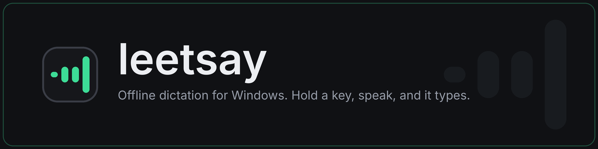

<p align="center">
  
</p>

Free, local dictation for Windows. Hold a hotkey, speak, let go: your words are
typed into whatever program you are using. (A Mac version is planned.)

leetsay has no accounts, statistics or tracking. See [How it works](#how-it-works)
and [PRIVACY.md](PRIVACY.md).

leetsay is free software, provided as is, without any warranty. Please read
the [Disclaimer](#disclaimer) before using it.

## How it works

- **Your microphone** is used only while you hold the hotkey (with "Press to start and stop":
  between one press and the next).
- **Your speech is turned into text on your own PC**, by a speech recognition
  model (NVIDIA's Parakeet) that runs locally. Your audio is not sent to a
  server for this, and it is not saved.
- **The model is downloaded once**, about 660 MB, from this project's own
  model page, [leetsay-models](https://github.com/sudo-csmith/leetsay-models) on github.com, after you agree in a window that says "This
  application will go online". The files there are converted in the open from
  NVIDIA's originals, and leetsay checks every file against a fingerprint built
  into it before using it. After that, leetsay needs no internet connection to
  work.
- **leetsay blocks its own network access while it runs.** It opens it only
  for a download you have just agreed to, only to github.com (and GitHub's
  server that delivers the files), and closes it again straight afterwards. It
  checks the block every time it starts (see
  [Checking the network block](#checking-the-network-block)).
- **App updates** are only checked if you ask: tick **Check for app updates
  at startup**, or click **Check for app updates now** (both off until you
  agree to go online, to github.com). leetsay only reads the latest version
  number and tells you; it does not download or install anything by itself.
  A newer speech model only ever comes with a newer version of leetsay.
- **This covers leetsay itself, not the programs you type into.** A chat, a web
  page or an online document may send your text over the internet; leetsay
  cannot see or control that. See the [Disclaimer](#disclaimer).

## What you need

- Windows 10 or 11, 64-bit.
- About 1 GB of free memory while it runs, and about 700 MB of disk space for
  the speech model.
- A microphone.

## Installing

### With the installer (recommended)

1. Open the [Releases](https://github.com/sudo-csmith/leetsay/releases) page
   and download the newest `leetsay-setup-<version>.exe`.
2. Run it. leetsay installs for your Windows user only, so no administrator
   password is needed. It adds leetsay to the Start menu; whether it starts
   with Windows is chosen in its introduction (and can be changed in Settings).

**"Windows protected your PC".** The installer is not signed with a paid
code-signing certificate yet, so Windows SmartScreen may show this warning for
a new download. To continue, choose **More info**, then **Run anyway**.

**Checking the download (optional).** Each release lists a long code called
a SHA-256 fingerprint. It is worked out from every byte of the installer, so if
the file were changed or damaged in any way, even by one letter, the code would
come out completely different. You don't have to check it; it is there for
anyone who wants to be extra sure they have the real, untouched file:

1. Open the folder you saved the installer to (usually **Downloads**).
2. Right-click an empty spot in the folder and choose **Open in Terminal**.
3. Type `Get-FileHash .\leetsay-setup-<version>.exe` (with the real version
   number) and press Enter.
4. Compare the long code after **Hash** with the one on the release page. If
   they are the same, the file is exactly the one that was published (capital
   or small letters don't matter). If they differ, don't run it: download it
   again from the Releases page.

### With Python

1. Install [Python 3.13](https://www.python.org/downloads/) (64-bit). During
   setup, tick **Add python.exe to PATH**. Please note: python.org is a
   third-party website that we do not run or control.
2. Download this repository (the green **Code** button, then **Download ZIP**)
   and unzip it to a folder of its own, for example `Documents\leetsay`.
   Keep it out of your Downloads folder.
3. Open that folder, click in the address bar, type `cmd` and press Enter.
   In the window that opens, run:

   ```
   py -3.13 -m pip install -r requirements.txt
   ```

4. Double-click `leetsay.pyw` to start it.

## The first time

1. Choose a colour and a look.
2. leetsay asks before it downloads the speech model (about 660 MB) from this
   project's model page on github.com, a third-party website that we do not run
   or control. Choose
   **Download**, or **Manual download** to fetch the files yourself with your
   web browser (the steps are shown), or **Quit**.
3. A short introduction shows the hotkey and lets you try it, and asks two
   things: whether your words should appear all at once when you let go (most
   accurate, the default) or as you speak, and whether it should look lively
   or calm.

After that, leetsay starts in the background (with Windows, if you like) and
shows a small icon by the clock. Windows may hide new icons behind the **^**
arrow by the clock; you can drag the icon out next to the clock to keep it in
sight.

## Using it

- **Hold the hotkey, speak, let go.** The text is typed where your cursor is.
  The hotkey is Ctrl+Space at first; you can change it, or switch to toggle
  mode, in Settings.
- **Settings:** click the leetsay icon by the clock. Starting leetsay again
  while it is running also opens Settings.
- **Cancel** a dictation: hover over the pop-up and click it.
- **Quit:** click the icon by the clock to open Settings, then **Quit leetsay**.
- **The dot on the pop-up is a status light:** your colour when leetsay is
  ready, amber while the speech model is loading, red when something needs you
  (no microphone, no sound from it, or no speech model). Click the pop-up to
  see what is wrong.

### Type as you speak

Turn on **Type as you speak** (Settings, Typing) and your words appear in
your program while you are still talking, about half a second behind you,
instead of all at once when you let go. You can keep holding the hotkey.

- It is less accurate than the normal mode, which is why it is off by
  default. In the normal mode the speech model hears your whole sentence
  before anything is typed, so small words like "and" or "on" come out right.
  Typing as you speak, each word is typed before the rest of the sentence is
  heard, and words already typed are not changed afterwards. Choose it if you
  prefer to see your words straight away.
- It only types into the window you started in. With **Text box detection**
  on (the default), it also waits until the cursor is in a text box, so that
  on a web page or a video your words are not taken as keyboard shortcuts.
  The pop-up says **No text box selected** while it waits.
- **Word replacements** (Settings, Typing) fix names and words the speech
  model doesn't know, such as "leaked say" written for "leetsay": you list what
  it writes and what you want instead. The list stays on this PC.
- **Remove filler words** (on by default) leaves out "um", "uh" and "erm", in
  both modes.

Good to know:

- Ctrl+Space is also used by some code editors (for suggestions) and by
  Chinese and Japanese keyboards (to switch input). While leetsay runs, it
  takes that key. If you need it, choose another hotkey in Settings.
- Windows does not let leetsay type into programs running as administrator.
  leetsay tells you when that happens.
- To move your settings to another PC, use **Export settings** and **Import
  settings** on the Privacy tab.

## Checking the network block

- In Settings, on the **Privacy** tab, the **Network** line says *blocked for
  this program (offline, checked at start)*.
- leetsay checks its network block every time it starts. The result is the
  second line of `%LOCALAPPDATA%\leetsay\dictate.log`:
  `Network block check: verified, all network access is refused`.
- You can also watch it yourself: open **Resource Monitor** (press Windows+R,
  type `resmon`, press Enter), go to the **Network** tab, and look for
  `leetsay.exe` (or `pythonw.exe`, if you run it with Python) under **Network
  Activity**. It should not appear there.

leetsay goes online only after you agree in a window that says "This
application will go online", and only to download the speech model.

## Uninstalling

### If you used the installer

Open Windows **Settings → Apps → Installed apps**, find **leetsay**, and
choose **Uninstall**, or click **Uninstall leetsay…** in leetsay's own Settings
(Privacy tab). The uninstaller removes the program and its start-up
entry, then asks whether to remove your settings and the downloaded speech
model as well.

### If you used Python

1. In Settings, on the **Model** tab, click **Remove model**. This deletes the
   speech model (about 630 MB).
2. Untick **Start with Windows** (General tab), then click **Quit leetsay**
   at the bottom of Settings.
3. Delete the folder `%LOCALAPPDATA%\leetsay` (paste that into the File
   Explorer address bar to open it). It holds your settings, the log and the
   speech model.
4. Delete the folder you put leetsay in.

The Python packages can be removed with
`py -3.13 -m pip uninstall -r requirements.txt`.

## Disclaimer

- **No warranty.** leetsay is free, open-source software, provided "as is",
  without warranty of any kind, express or implied. In no event shall the
  author be liable for any claim, damages or other liability arising from it
  or its use. The full terms are in the [LICENSE](LICENSE). You use leetsay
  entirely at your own risk.
- **The text comes from a speech model made by others.** It can mishear,
  leave out or add words, including words that were never said. The author of
  leetsay does not control, and is not responsible for, the text the model
  produces. Check it before you use it.
- **Speech recognition makes mistakes.** How well it works depends on your
  voice, accent, language, microphone and background noise (NVIDIA's model
  card, linked in [CREDITS.md](CREDITS.md), describes its known limits). Always check text before you send or submit it, especially
  if you set leetsay to press Enter after a dictation.
  Do not rely on leetsay where a wrong, missing or misplaced word could cause
  harm or loss, such as medical, legal, financial, safety or emergency use.
- **Where the text goes is up to you.** leetsay types into whichever window
  has the focus when your dictation ends (with **Type as you speak**, into the
  window you started in, while you speak; **Text box detection** is a help, not
  a guarantee: some programs do not say what has the focus). It cannot know or control which
  program, chat, form or document that is, or what that program then does with
  the text: send it, save it, share it or upload it. Check where your cursor is
  before you speak, especially if you set **After each dictation** to press
  Enter, and do not dictate passwords or other sensitive information. People near
  you can hear what you say, and anyone who can see your screen can read the
  words in the pop-up as you speak.
- **Not an assistive or medical device.** leetsay is not certified for
  accessibility or medical use. If you depend on dictation to use your
  computer, keep another way to type available.
- **Your responsibility.** You are responsible for how you use leetsay and for
  what it types on your behalf, including following any laws or rules about
  recording or processing speech that apply where you are, getting consent
  where other people's voices may be picked up, and following the rules of
  your employer or school.
- **Third parties.** The speech models, libraries and websites leetsay uses
  belong to others and come with their own licences and terms (see
  [CREDITS.md](CREDITS.md)). Websites mentioned here are third-party websites
  that we do not run or control.
- **No affiliation.** leetsay is an independent project. It is not affiliated
  with, endorsed or sponsored by NVIDIA, GitHub, Microsoft or the Python
  Software Foundation. NVIDIA, Parakeet, GitHub, Windows and Python are
  trademarks of their respective owners, used here only to describe what
  leetsay works with.
- **Official downloads only.** Only releases published on this repository's
  [Releases](https://github.com/sudo-csmith/leetsay/releases) page are
  official. Copies offered anywhere else may have been changed.
- **No support obligation.** Help, fixes and updates are offered when possible,
  with no promise of any, and no promise that leetsay or its speech model
  downloads stay available. Any version may be withdrawn, for example if a
  problem is found.
- **Limits of these terms.** Nothing here limits any liability that cannot be
  limited by law. If any part cannot be enforced, the rest still applies. The
  terms that come with each version apply to that version; the installer shows
  them in full.

## Licence and credits

leetsay is released under the MIT licence, see [LICENSE](LICENSE). The speech
models are by NVIDIA under CC-BY-4.0; see [CREDITS.md](CREDITS.md) for these
and the libraries leetsay uses.

Security problems: see [SECURITY.md](SECURITY.md).
